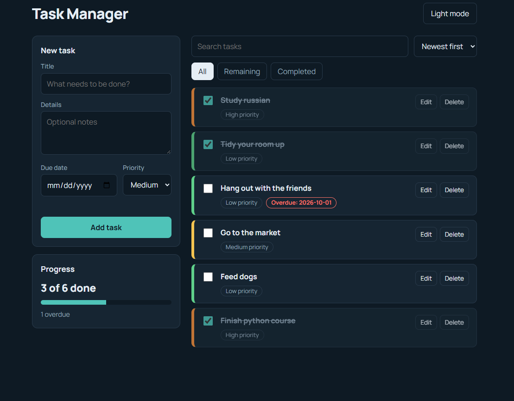

Task Manager

A clean, fast task manager that runs entirely in the browser. Add tasks with a due date and priority, track your progress, and pick up exactly where you left off, with no account, no server and no installation.

Live demo: https://osamamohamedgamal57-star.github.io/task-manager/

Why I built it

I wanted a project that covers the core skills of front-end development from start to finish: structuring a page, designing a responsive interface, managing application state in JavaScript, and storing data in the browser. I deliberately used no frameworks or libraries, so that every part of the code is written and understood by me.

Features
Create, edit and delete tasks, each with a title, optional details, due date and priority (low, medium, high)
Mark tasks as completed with a checkbox
Filter tasks by All, Remaining or Completed
Search by title or details
Sort by newest, due date or priority
Progress bar that shows how many tasks are done, plus an overdue counter
Overdue highlighting for tasks whose due date has passed
Light and dark mode, which follows your system setting on the first visit and remembers your choice afterwards
Automatic saving: tasks stay in the browser (localStorage) after closing or refreshing the page
Responsive layout that works on phones, tablets and desktops
Input validation (a task cannot be saved without a title)
Built with
HTML5 for the page structure
CSS3 (custom properties for theming, Grid and Flexbox for layout, media queries for mobile)
JavaScript (ES6) with no frameworks or external libraries
localStorage for saving data in the browser
GitHub Pages for hosting
How to use
Open the live demo link above (or open index.html in any browser).
Type a title in the New task form, optionally add details, a due date and a priority, then press Add task.
Tick the checkbox to complete a task, or use Edit and Delete on the right side of the task.
Use the search box, the sort menu and the filter buttons to find what you need.
Use the button in the top corner to switch between light and dark mode.
Project structure
task-manager/
├── index.html   # Page structure: form, filters, task list
├── style.css    # Styling, light and dark themes, responsive layout
├── script.js    # Application logic: state, rendering, storage, events
└── README.md    # Project description
How it works
The application keeps all tasks in one JavaScript array (the state).
Every action (add, edit, delete, complete, filter, search, sort) updates that array and then calls a single render() function, which rebuilds the task list on the page from the current state.
After every change the array is saved to localStorage as JSON, and it is loaded again when the page opens.
Task text is inserted with textContent instead of innerHTML, so anything a user types is displayed as plain text and cannot inject HTML or scripts into the page.
What I learned
Keeping a single source of truth for the data and rendering the interface from it
Handling user events and updating the DOM safely
Persisting data with localStorage, including handling errors when storage is unavailable
Building a theme system with CSS variables
Designing a layout that adapts from desktop to mobile
Possible improvements
Drag and drop to reorder tasks
Task categories or tags
Export and import tasks as a file
Browser notifications for upcoming deadlines
Author

Osama Mohamed Gamal GitHub: osamamohamedgamal57-star
